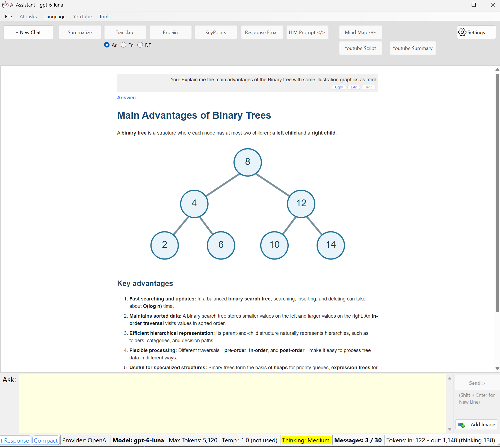

# AI Assistant

A powerful Windows Forms application that provides a user-friendly interface for interacting with various AI models. 
The application supports multiple AI providers, image analysis, and specialized AI tasks.


## Features

- 🤖 **Multiple AI Providers**
  - OpenAI
  - DeepSeek
  - Gemini
  - Anthropic (Claude)
  - Configurable through settings: model, temperature, thinking level, max tokens and max messages

- 🎯 **Specialized AI Tasks**
  - Standard chat
  - Text summarization
  - Translation (Arabic, English, German)
  - Text explanation
  - Key points extraction
  - Email response generation
  - Image analysis
  - Prompt generation
  - Mind map generation
  - YouTube transcript fetching
  - YouTube transcript summarization

- 🖼️ **Image Analysis**
  - Clipboard image capture
  - Image file upload
  - AI-powered image explanation
  - Pasted images are saved in the `Temp_Images` folder next to the exe and deleted when the app closes. File > Open Images Folder opens it; File > Clear Images deletes them at any time, after a confirmation (images chosen with Add Image are your own files and are never deleted)
  - DeepSeek does not accept images: the app tells you so instead of sending only the text

- 🗂️ **Chat History**
  - Every chat is saved automatically as a session (a new chat starts a new session)
  - File > History reopens recent sessions and continues them; the LLM context is rebuilt from the chat with the latest messages that fit the maximum number of messages, exactly as a live chat holds them (the chat view shows everything). The context is derived from the chat before every request, so it cannot drift from it. Max Messages counts the system message and the question being asked, so a maximum of 6 means the LLM remembers the last 4 messages
  - Sessions are stored as JSON in the `History` folder next to the exe

- 🗜️ **Compact Conversation**
  - The status bar shows the messages used by the LLM context (`Messages: used / max`)
  - **Compact** (the status bar button, or typing `/compact` and sending it) summarizes the conversation and starts a new LLM context from the summary: the counter is back to `1 / max`
  - The chat view and the history keep every message, including the summary; the status bar shows **Compacted**
  - The summarizing prompts (`Compact`, `CompactContext`) are editable like all other prompts
  - A cut-off or empty summary does not compact the conversation: the current context is kept and a message explains why
  - **Copy Last Response** copies the last answer; every message also has its own Copy button, under the text on the right
  - **Edit** (on the last question): change it and press **Send** to replace the question and its answer, in the LLM context, the chat and the history

- 📊 **Status Bar**
  - Shows the provider, the model (bold), max tokens, temperature, thinking level and messages; clicking any of them opens the Settings
  - The thinking level is highlighted in yellow when the model takes one. A setting the model does not use is marked `(not used)` (for example the temperature while a model thinks), and `None (lowest)` means the model cannot turn thinking off
  - The message counter turns orange at 75% and red at 90% of the maximum
  - The tokens of the last request and its answer, as reported by the provider: `Tokens: in: 1,234 - out: 567 (thinking 400)`. `~` marks an estimate, while waiting or when the provider reports none

- ⚠️ **Helpful Notifications**
  - An empty answer (for example when the thinking used all the max tokens) is not added to the chat; a message explains why and what to change (Max Tokens or the thinking level)
  - A cut-off answer is kept, with a note in the status bar; an answer blocked by the provider's safety filter is reported as such
  - A failed request shows the reason in the status bar (for example `Request failed: API key rejected`) and a message with what to do (check the key or model name, lower Max Tokens, compact a too long conversation, wait for a rate limit, check the connection, ...) followed by the provider's details

- 📝 **Editable Prompts**
  - All system prompts and user templates are stored in `prompts.json`
  - Edit them in Settings > Edit Prompts (or directly in the file); changes apply without a restart

- 💻 **Modern UI**
  - Clean, intuitive interface
  - HTML-formatted responses
  - Real-time interaction
  - Adjustable context window
  - The window opens with the size it had when it was last closed (stored in `window.json` next to the exe)
  - The title and the welcome page of a new chat show the model in use


## Prerequisites

- Windows OS
- .NET 8.0 SDK
- Visual Studio 2022 or later
- WebView2 Runtime
- Python 3.10+ (optional, required only for YouTube transcript features)
  - Python virtual environment configured (see `Constants.PythonConstants` for paths)

## Installation

1. Clone the repository:
```bash
git clone https://github.com/MohammedJayyab/AI_Assistant
```

2. Open the solution in Visual Studio:
```bash
cd AI_Assistant
```

3. Configure your AI provider settings:
   - Copy `AI_Assistant/appsettings.example.json` to `AI_Assistant/appsettings.Local.json`
   - Update the API keys and model settings in `appsettings.Local.json`

4. Build and run the application:
```bash
dotnet build
dotnet run
```

## Configuration

The application uses JSON configuration files for settings:

- `AI_Assistant/appsettings.example.json`: Template configuration file
- `AI_Assistant/appsettings.Local.json`: Your local configuration (not tracked in source control)

Example configuration:
```json
{
  "LLM": {
    "DefaultProvider": "Gemini",
    "DefaultMaxTokens": "4096",
    "OpenAI": {
      "ApiKey": "YOUR-OpenAI-KEY",
      "Model": "gpt-3.5-turbo",
      "Temparature": "1.0"
    },
    "DeepSeek": {
      "ApiKey": "YOUR-DeepSeek-KEY",
      "Model": "deepseek-chat",
      "Temparature": "0.3"
    },
    "Gemini": {
      "ApiKey": "YOUR-Gemini-KEY",
      "Model": "gemini-2.0-flash",
      "Temparature": "0.3"
    },
    "Anthropic": {
      "ApiKey": "YOUR-Anthropic-KEY",
      "Model": "claude-sonnet-5-5",
      "Temparature": "0.3"
    }
  },
  "Conversation": {
    "DefaultMaxMessages": "30"
  }
}
```

Each provider can also have an optional `"ReasoningEffort"` (`None`, `Low`, `Medium` or `High`); without it the model uses its default thinking. The Settings dialog writes all of these values for you.

Files the application creates next to the exe:

| File / folder | Content |
|---|---|
| `appsettings.local.json` | Your settings, copied from the example on the first start |
| `prompts.json` | The editable system prompts and user templates |
| `History/` | One JSON file per chat session |
| `Temp_Images/` | Pasted images, deleted when the app closes |
| `window.json` | The window size, used on the next start |

## Usage

1. **Standard Chat**
   - Type your message in the input box
   - Press Enter or click "Send"

2. **Specialized Tasks**
   - Enter your text
   - Select the appropriate task button (Summarize, Translate, Explain, KeyPoints, Email Response, Prompt, Mind Map)
   - Get AI-powered response

3. **Image Analysis**
   - Use "Add Image" button to select an image file
   - Or use "Ctrl + V" to capture from clipboard
   - Write your prompt or click 'Send' for AI analysis (OpenAI, Gemini or Anthropic; DeepSeek does not accept images)

4. **Language Translation**
   - Choose between Arabic (Ar), English (En), or German (De) using radio buttons
   - Default is Arabic
   - Click "Translate" button after selecting language

5. **YouTube Features**
   - **YouTube Script**: Paste a YouTube URL and click "Youtube Script" to fetch the transcript
   - **YouTube Summary**: Paste a YouTube URL and click "Youtube Summary" to get transcript with key points
   - Note: Requires Python environment configured (see PythonConstants in Constants.cs)


## Solution Structure

```
AI_Assistant/
├── AI_Assistant/                      # Main project directory
│   ├── frmAssistant.cs               # Main form implementation
│   ├── frmAssistant.Designer.cs      # Main form design
│   ├── frmAssistant.resx             # Main form resources
│   ├── frmModelSettings.cs           # Model settings form implementation
│   ├── frmModelSettings.Designer.cs # Model settings form design
│   ├── frmModelSettings.resx         # Model settings form resources
│   ├── frmPromptSettings.cs          # Prompt editor form implementation
│   ├── frmPromptSettings.Designer.cs # Prompt editor form design
│   ├── LLMModel.cs                   # LLM model factory and configuration
│   ├── AppSettings.cs                # Configuration file management
│   ├── PromptSettings.cs             # Prompts and the prompts.json store
│   ├── ChatHistory.cs                # Chat sessions saved in the History folder
│   ├── Constants.cs                  # Application constants
│   ├── ImageHelper.cs                # Image handling utilities (pasted images)
│   ├── RequestErrorHelper.cs         # Reason and advice for failed requests
│   ├── TokenEstimator.cs             # Token estimate while waiting for a response
│   ├── WindowSettings.cs             # Window size kept between starts
│   ├── SleekRenderer.cs              # Status bar look (buttons, highlight)
│   ├── Htmltemplate.cs               # HTML templates for WebView2
│   ├── YoutubeTranscriptFetcher.cs    # YouTube transcript fetching (Python integration)
│   ├── Program.cs                    # Application entry point
│   ├── appsettings.example.json      # Configuration template
│   ├── images/                       # Application images and icons
│   │   ├── assistant.ico
│   │   ├── settings.ico
│   │   └── ...
│   ├── Properties/                    # Application properties
│   │   ├── Resources.resx
│   │   └── Resources.Designer.cs
│   └── AI_Assistant.csproj           # Project file
└── AI_Assistant.sln                  # Solution file
```

## Dependencies

- Microsoft.Web.WebView2 (v1.0.3240.44) - For HTML rendering in the chat interface
- Microsoft.Extensions.Configuration.Json (v9.0.5) - For JSON configuration management
- pythonnet (v3.0.5) - For Python integration (YouTube transcript features)
- [LLMKit](https://github.com/MohammedJayyab/LLMKit) (v4.0.0) - A thread-safe .NET library that provides a unified interface for interacting with various Large Language Models (LLMs)

### LLMKit Integration

This application uses [LLMKit](https://github.com/MohammedJayyab/LLMKit) as its core library for AI model interactions. LLMKit provides:

- Unified interface for multiple LLM providers (OpenAI, Gemini, DeepSeek, Anthropic)
- Thread-safe implementation
- Conversation management
- Per-model reasoning (thinking level): each model gets only the parameters it accepts
- Token usage, finish reason (complete, cut off or blocked) and model capabilities for every response
- Fluent API for message building
- Configurable parameters (tokens, temperature, etc.)
- Comprehensive error handling
- Dependency injection support
- Cancellation token support
- Custom endpoint support for all providers

## Development

### Adding New Features

1. **New AI Task**
   - Add the prompt key in `Constants.Prompts` and its default prompt in `PromptSettings.CreateDefault`
   - Create button in form designer
   - Implement handler in `frmAssistant.cs` (usually `RunPromptAsync` with the new key)

2. **New AI Provider**
   - The provider must exist in LLMKit (`LLMClient.GetSupportedProviders()` lists them)
   - Add it to `Constants.Providers` and create its client in `LLMModelFactory` (`LLMModel.cs`)
   - Add its section to `appsettings.example.json`

### Configuration Settings

The application includes a Model Settings dialog (`frmModelSettings`) that allows you to:
- Select default AI provider (OpenAI, Gemini, DeepSeek, Anthropic)
- Configure the temperature (0.0 - 1.0) of each provider; the box shows the temperature of the provider selected above it
- Choose the thinking level (Default, None, Low, Medium, High) of each provider; it is stored as an optional `ReasoningEffort` value in the provider's section, and Default (no value) lets the provider decide. LLMKit 4.0.0 sends it only to models that support thinking, in the form each model accepts; the status bar highlights it in yellow when the model takes a thinking level, marks it `(not used)` when the model does not use it, and `None (lowest)` when the model cannot turn thinking off. The temperature is marked `(not used)` the same way (for example while a model thinks)
- Set maximum tokens (1000 - 100,000): the length of each response, thinking plus answer. It is sent as set; a value above the model's limit is rejected by the provider
- Set maximum conversation messages (2 - 100)
- Edit configuration directly via "Edit Json File" button
- Changing settings during a conversation asks for confirmation first (No undoes the change); the LLM context is rebuilt from the chat
- Reload settings via "Load" button

### Best Practices

- Follow SOLID principles
- Maintain clean code structure
- Use proper error handling
- Keep UI responsive
- Document new features
- Clear ComboBox items before repopulating to prevent duplicates

## Contributing

1. Fork the repository
2. Create a feature branch
3. Commit your changes
4. Push to the branch
5. Create a Pull Request

## License

MIT 